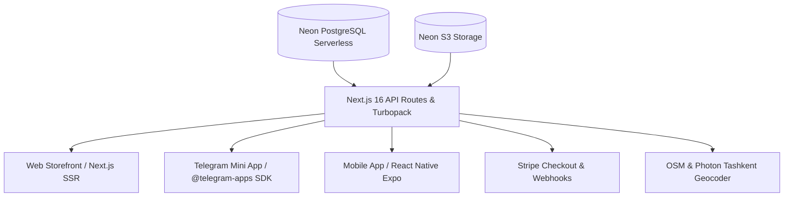

# Презентация экосистемы интернет-магазина APEX TECH

Формат: 90-секундный продуктовый ролик (Loom / запись экрана с демонстрацией клиентам, жюри или инвесторам).

---

## Архитектура проекта

---

## Посекундный сценарий видео-демонстрации

### 0:00 – 0:15 | Блок 1: Витрина и поиск (Web)
* **Что на экране:** Открытие главной страницы `http://localhost:3000`. Плавный скролл каталога с Bento-сеткой (флагманы, популярное, новинки).
* **Действие:** Ввод в поисковую строку запроса *«Samsung»*, применение фильтра по бренду и сортировка по цене.
* **Текст диктора:**  
  > «APEX TECH — омниканальная платформа продажи электроники в Ташкенте. Полноценный каталог с Bento-сеткой, мгновенной фильтрацией и живым поиском. Данные синхронизируются через Serverless PostgreSQL в Neon.»

### 0:15 – 0:40 | Блок 2: Оформление заказа и карта доставки (в стиле Яндекс Go)
* **Что на экране:** Карточка товара, добавление в корзину, переход в `/checkout`. Экран выбора адреса доставки.
* **Действие:** В строке поиска адреса вводится *«Чорсу»*. Появляется выпадающий список объектов Ташкента. Клик по объекту — маркер на карте плавно центрируется на рынке Чорсу. Перетаскивание маркера мышью — адрес снизу автоматически пересчитывается. Заполнение полей: подъезд, этаж, квартира. Нажатие «Подтвердить этот адрес для доставки».
* **Текст диктора:**  
  > «Чекаут адаптирован под городскую доставку: пользователь вводит улицу, метро или ТЦ, интерактивная карта центрирует маркер, а курьер получает точные координаты с номером подъезда и этажа. Для оплаты интегрирован международный эквайринг Stripe и расчет при получении.»

### 0:40 – 0:55 | Блок 3: Telegram Mini App
* **Что на экране:** Открытие магазина внутри клиента Telegram через кнопку бота. 
* **Действие:** Показ автоматического разворачивания на весь экран (`tg.expand()`), приветственный бейдж с именем аккаунта Telegram, навигация по каталогу пальцем в мобильном интерфейсе.
* **Текст диктора:**  
  > «Магазин работает как нативный Telegram Mini App без отдельной верстки. Пользователь заходит прямо из чата Telegram: система автоматически подтягивает профиль, разворачивает экран на 100% и поддерживает тактильный отклик при добавлении товара.»

### 0:55 – 1:15 | Блок 4: Мобильное приложение (React Native / Expo)
* **Что на экране:** Запущенное через Metro Bundler мобильное приложение в Expo Go на смартфоне.
* **Действие:** Переключение вкладок «Каталог», «Корзина», «Избранное», плавные нативные анимации списков.
* **Текст диктора:**  
  > «Для мобильных пользователей разработано приложение на React Native и Expo. Единый API, мгновенный отклик и работа через облачный туннель без привязки к локальной сети.»

### 1:15 – 1:30 | Финал: Стек и готовность к запуску
* **Что на экране:** Сводный экран со статусом репозитория GitHub (`Hrest404/market`), базы данных Neon и запущенных сервисов.
* **Текст диктора:**  
  > «Стек проекта: Next.js 16 на Turbopack, React 19, React Native Expo, PostgreSQL Neon, Leaflet и Stripe. Единая база данных, три канала продаж: веб-сайт, Telegram Mini App и мобильное приложение.»
